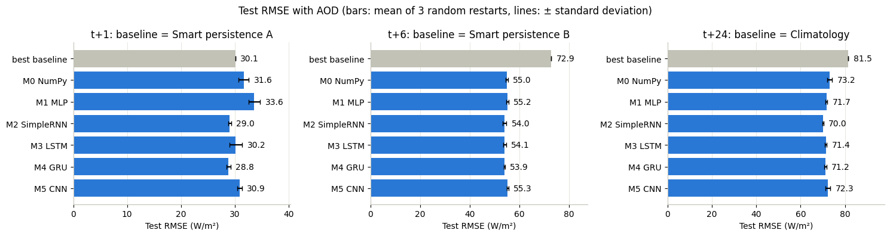
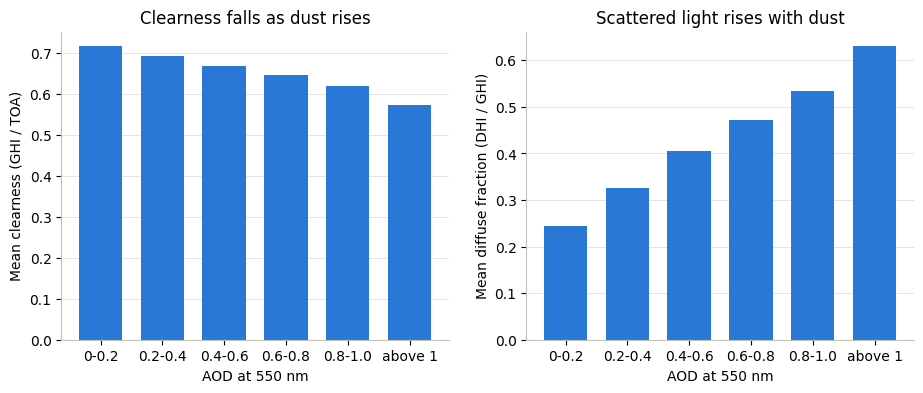
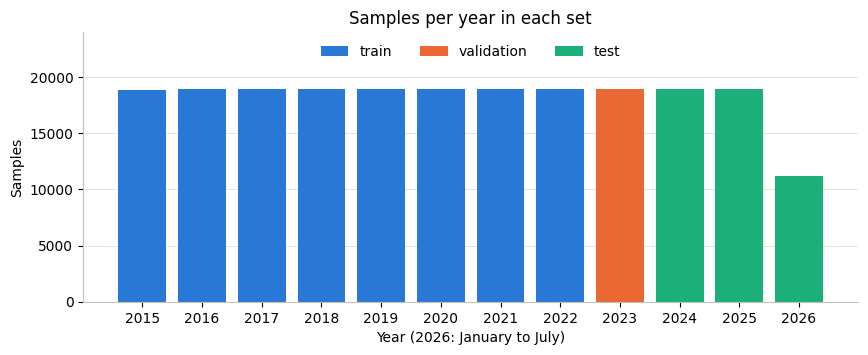
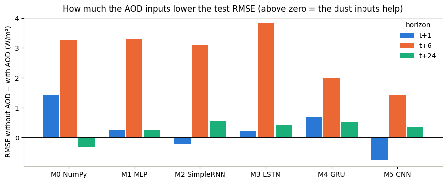
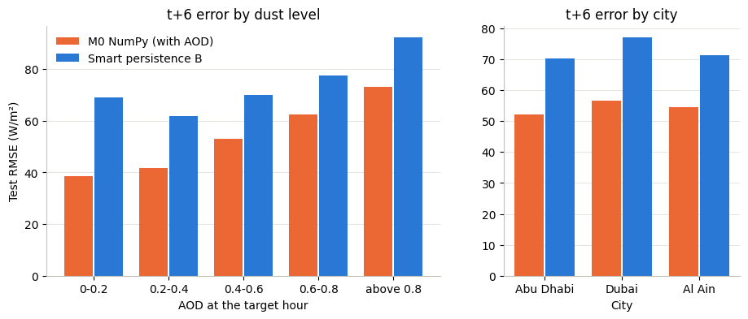
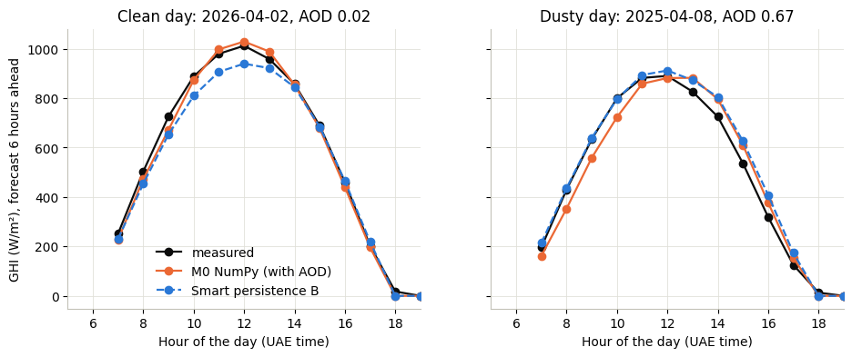
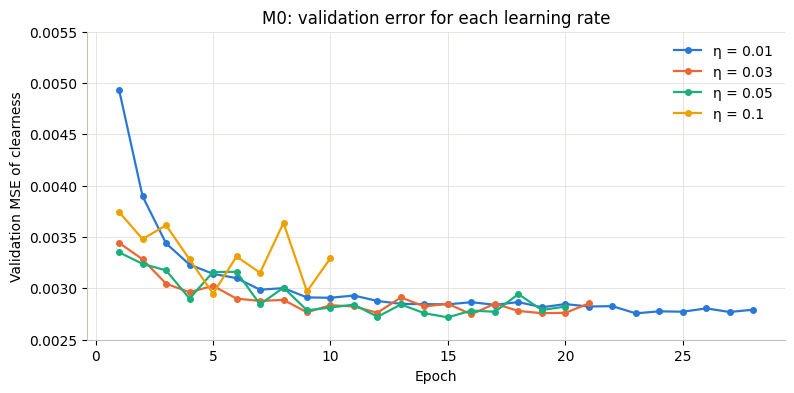

# Dust-Aware Neural Network Forecasting of Hourly Solar Irradiance in the UAE

[](https://www.python.org/)
[](https://keras.io/)
[](https://numpy.org/)
[](https://colab.research.google.com/github/Ariharanmurugan/Dust-Aware-Solar-Forecasting/blob/main/notebooks/UAE_Solar_Forecasting.ipynb)
[](LICENSE)

Six neural networks forecast hourly global horizontal irradiance (GHI) for Abu Dhabi, Dubai and Al Ain, 1, 6 and 24 hours ahead. One of them is a multilayer perceptron written from scratch in NumPy, with backpropagation, momentum and weight decay implemented by hand. The question the project sets out to answer is whether telling a network about desert dust, through aerosol optical depth (AOD), makes its forecasts more accurate.

The answer, on this data, is: clearly yes at 6 hours, in every architecture tested; not at 1 or 24 hours.

## Results

Networks were selected on a held-out validation year (2023) and scored once on the test years (January 2024 to July 2026). Scores are RMSE on daylight hours, in W/m², averaged over three random restarts.

| Horizon | Network selected on 2023 | Test RMSE | Strongest simple forecast | Error reduction |
|---|---|---|---|---|
| 1 hour | M4 GRU, with dust | 28.8 | Smart persistence A, 30.1 | 4.3% |
| 6 hours | M0 NumPy MLP, with dust | 55.0 | Smart persistence B, 72.9 | 24.5% |
| 24 hours | M1 Keras MLP, without dust | 71.9 | Climatology, 81.5 | 11.8% |



One hour ahead, persistence is hard to beat: only the GRU and the SimpleRNN improve on it. Six hours ahead is where the networks earn their keep.

## Contents

- [Why dust](#why-dust)
- [Data](#data)
- [Method](#method)
- [All networks](#all-networks)
- [Effect of the dust inputs](#effect-of-the-dust-inputs)
- [Where the errors are](#where-the-errors-are)
- [The network written from scratch](#the-network-written-from-scratch)
- [Repository layout](#repository-layout)
- [Running it](#running-it)
- [Limitations](#limitations)
- [Team](#team)
- [Acknowledgement, references and licence](#acknowledgement-references-and-licence)

## Why dust

A solar plant's output follows GHI, the sunlight reaching flat ground, and grid operators plan reserves, storage and market bids from minutes to a day ahead. In the UAE many days are free of cloud, but the sky is rarely clean: desert dust absorbs and scatters sunlight. One pair of days from the data makes the point. On 1 May 2016 Abu Dhabi had an AOD of 0.92 and received 6.83 kWh/m². The next day, at AOD 0.18 and a similar cloud amount, it received 8.16 kWh/m², 16% more.

The dust is not a rare event here. Mean AOD across the three cities is 0.45, and it peaks in summer.

The effect is visible in the physics before any network is trained. On the 25,269 cloud-free daylight hours in the dataset, as AOD rises the sky gets dimmer and the light that does arrive becomes more scattered:

| AOD | 0 to 0.2 | 0.2 to 0.4 | 0.4 to 0.6 | 0.6 to 0.8 | 0.8 to 1.0 | above 1 |
|---|---|---|---|---|---|---|
| Clearness index | 0.715 | 0.691 | 0.668 | 0.645 | 0.620 | 0.572 |
| Diffuse fraction | 0.245 | 0.327 | 0.406 | 0.473 | 0.534 | 0.630 |
| Hours | 4,218 | 10,366 | 6,801 | 2,510 | 879 | 495 |



So the dust variables carry real information. Whether a forecasting network can use it is a separate question, and the one this project tests.

**Research question.** Can neural networks forecast hourly GHI in the UAE better than strong simple forecasts, and does dust information make them more accurate, 1, 6 and 24 hours ahead?

## Data

NASA POWER hourly data for three sites: Abu Dhabi (24.45 N, 54.37 E), Dubai (25.20 N, 55.27 E) and Al Ain (24.21 N, 55.74 E), from 1 January 2015 to 31 July 2026. That is 304,560 records, 101,520 per city, with no gap and no duplicated hour.

Seventeen parameters were downloaded:

| Group | Variables | Product |
|---|---|---|
| Irradiance and sun | all-sky GHI, clear-sky GHI, DNI, DHI, clearness index, solar zenith angle, cloud amount | CERES SYN1deg |
| Dust | AOD at 550 nm, AOD at 840 nm | CERES SYN1deg |
| Weather | 2 m temperature, dew point, relative and specific humidity, 10 m wind speed and direction, surface pressure, precipitation | MERRA-2 |

The dataset file is not in this repository. `data/README.md` explains how to obtain it and gives the SHA-256 fingerprint the notebook checks before use.

No open, ground-measured irradiance for the UAE could be found, so the forecast target is a satellite estimate rather than a pyranometer reading. That limitation is taken seriously below.

## Method

**Target.** The networks predict the clearness index KT = GHI / top-of-atmosphere irradiance, at t+1, t+6 and t+24. Predicting KT removes the daily sun cycle, which is known in advance and would otherwise dominate the error. Forecasts are converted back to GHI (KT x TOA, zero at night) before scoring.

**Inputs.** 28 values per hour in five groups: sunlight (6), sun position and season (5), dust (4), weather (10) and a one-hot city code (3). The four dust inputs are AOD at 550 nm, AOD at 840 nm, the Angstrom exponent and the hourly change in AOD. Removing them leaves the 24 inputs of the "without dust" runs.

**Samples.** Each forecast time uses the previous 24 hours of those inputs, a 24 x 28 window, plus 6 values that are genuinely known in advance: the cosine of the solar zenith angle and the top-of-atmosphere irradiance at the three target hours. That gives 219,598 forecast times.

**Split, by time and never shuffled across the cut:**

| Split | Period | Samples | Used for |
|---|---|---|---|
| Train | 2015 to 2022 | 151,551 | fitting weights |
| Validation | 2023 | 18,939 | early stopping, learning rate, model selection |
| Test | Jan 2024 to Jul 2026 | 49,108 | final scores only |

Scaling statistics come from the training years alone. The 66 targets whose horizon crosses into the next split are dropped. Targets with the sun more than 85 degrees from the zenith carry zero weight in the loss and in every score, so night hours cannot flatter the results.



**Networks.** All six take the same inputs and end the same way: the window encoding is concatenated with the 6 known future values, then Dense(64, tanh), then three linear outputs, one per horizon.

| Model | Window encoder | Parameters | Training |
|---|---|---|---|
| M0 NumPy MLP | flatten, 678 inputs to 64 tanh | 43,651 | mini-batch SGD, batch 256, momentum 0.9, L2 1e-4, learning rate 0.05 |
| M1 Keras MLP | flatten | 43,651 | Adam 0.001, gradient clipping 1.0, dropout 0.2 |
| M2 SimpleRNN | 64 units | 10,691 | as M1 |
| M3 LSTM | 64 units | 28,547 | as M1 |
| M4 GRU | 64 units | 22,787 | as M1 |
| M5 1-D CNN | 32 filters, kernel 3, ReLU, max pooling 2 | 27,939 | as M1 |

Every run uses batch 256, at most 60 epochs and early stopping on the validation loss with patience 5, restoring the best weights. The Keras settings (64 units, dropout 0.2, Adam 0.001) were not tuned; only M0's learning rate was, over 0.01, 0.03, 0.05 and 0.1, picking 0.05.

The full experiment is 6 architectures x (with / without dust) x 3 random restarts, which is **36 trained networks**.

**Reference forecasts.** Four forecasts that learn nothing, built from past data and training-period statistics only. The best per horizon is chosen on 2023, not on the test years.

| Reference | 1 h | 6 h | 24 h |
|---|---|---|---|
| Same hour yesterday | 85.6 | 85.6 | 85.6 |
| Climatology | 81.5 | 81.5 | **81.5** |
| Smart persistence A | **30.1** | 82.0 | 85.7 |
| Smart persistence B | 38.9 | **72.9** | 85.6 |

Test RMSE in W/m². Bold marks the reference selected on the validation year, which here is also the best on test.

## All networks

Test RMSE in W/m², mean of three restarts:

| Model | 1 h with dust | 6 h with dust | 24 h with dust | 1 h without | 6 h without | 24 h without |
|---|---|---|---|---|---|---|
| M0 NumPy MLP | 31.6 | 55.0 | 73.2 | 33.1 | 58.3 | 72.9 |
| M1 Keras MLP | 33.6 | 55.2 | 71.7 | 33.9 | 58.5 | 71.9 |
| M2 SimpleRNN | 29.0 | 54.0 | 70.0 | 28.8 | 57.1 | 70.6 |
| M3 LSTM | 30.2 | 54.1 | 71.4 | 30.4 | 58.0 | 71.9 |
| M4 GRU | **28.8** | **53.9** | 71.2 | 29.5 | 55.9 | 71.7 |
| M5 1-D CNN | 30.9 | 55.3 | 72.3 | 30.2 | 56.8 | 72.6 |

The lowest mean error at every horizon comes from a recurrent network, most clearly at 1 hour, where the GRU's 28.8 beats the plain MLP's 33.6. At 6 and 24 hours the gaps between architectures are comparable to the spread between random restarts, so no single best architecture is claimed from one test period.

The choice made on 2023 is not always the best on test. At 6 hours the GRU reaches 53.9 against M0's 55.0, and at 24 hours the SimpleRNN reaches 70.0 against the MLP's 71.9. Selecting on the validation year and reporting whatever that choice scores is what keeps the headline honest.

## Effect of the dust inputs

RMSE without dust inputs minus RMSE with them, in W/m², mean of three restarts. A positive number means the dust inputs helped.

| Horizon | M0 | M1 MLP | M2 SimpleRNN | M3 LSTM | M4 GRU | M5 CNN |
|---|---|---|---|---|---|---|
| 1 h | +1.4 | +0.3 | -0.2 | +0.2 | +0.7 | -0.7 |
| 6 h | **+3.3** | **+3.3** | **+3.1** | **+3.9** | **+2.0** | **+1.4** |
| 24 h | -0.3 | +0.2 | +0.6 | +0.4 | +0.5 | +0.4 |



Six hours ahead, every one of the six architectures improves, by 1.4 to 3.9 W/m², and each gain is larger than that network's spread across restarts. At 1 and 24 hours the change is under 1.5 W/m² and its sign varies, which is noise.

A plausible reading, which this project did not test: one hour ahead the most recent irradiance measurement already encodes the current dust, so naming it adds nothing; a day ahead the dust itself has moved on, so today's value is stale. Six hours is long enough for dust to matter and short enough for it to persist.

**Two caveats, and they matter.**

1. The forecast target and the dust inputs come from the same satellite product, CERES SYN1deg. Part of the measured benefit could reflect how that product uses its own aerosol input, rather than physics a ground sensor would confirm.
2. The "without dust" inputs are not dust-blind. DNI, DHI, the diffuse fraction and clear-sky GHI all respond to aerosol. So the measured gain is a lower bound on what dust information adds, not a clean measurement of it.

## Where the errors are

Six-hour forecasts from M0 with dust, first restart, on the test years:

| AOD at the target hour | 0 to 0.2 | 0.2 to 0.4 | 0.4 to 0.6 | 0.6 to 0.8 | above 0.8 |
|---|---|---|---|---|---|
| Network RMSE | 38.5 | 41.8 | 53.0 | 62.5 | 73.2 |
| Smart persistence B | 69.0 | 61.8 | 70.1 | 77.4 | 92.2 |
| Daylight test hours | 2,438 | 9,691 | 9,299 | 5,789 | 4,929 |

Error climbs steadily with dust, which is expected: dusty hours are harder. The network stays 15 to 31 W/m² ahead of the reference at every level, including the dustiest.

By city, the same forecasts give 52.3 (Abu Dhabi), 54.6 (Al Ain) and 56.7 (Dubai) W/m², against 70.2, 71.4 and 77.0 for the reference.



Two test days, the cleanest and the dustiest of the low-cloud test days, picked on AOD alone:



## The network written from scratch

M0 uses no deep learning framework. The forward pass, the masked error, the backward pass and the weight update are four NumPy functions:

```text
net_k = sum_i w_ki x_i + b_k,     O_k = tanh(net_k)             hidden layer
net_o = sum_k w_ok O_k + b_o,     O_o = net_o                   linear output
E     = 1/2 sum_o m_o (t_o - O_o)^2                             m_o = 0 at night
delta_o = m_o (t_o - O_o)                                       linear output, slope 1
delta_k = (1 - O_k^2) sum_o delta_o w_ok
Delta_w(n+1) = eta (delta x - lambda w(n)) + alpha Delta_w(n)    momentum and L2, not on biases
```

Before it was trained on real data, the same four functions were run on a small 2-2-1 sigmoid network and reproduced an independent hand calculation to four decimal places over two epochs, with and without weight decay. That check is referenced in the notebook but not reproduced there, because it is built on teaching material from the module.

M0 is not a toy result. Against the same-shaped Keras MLP it is better at 1 hour (31.6 against 33.6), level at 6 hours (55.0 against 55.2) and worse at 24 hours (73.2 against 71.7); the two differ in optimiser and regularisation. It is the network the validation year selected for the 6-hour horizon.



## Repository layout

```text
Dust-Aware-Solar-Forecasting/
├── notebooks/
│   └── UAE_Solar_Forecasting.ipynb    the full study, outputs included
├── data/
│   └── README.md                      how to obtain the dataset, and its fingerprint
├── images/                            the 14 figures the notebook produces
├── requirements.txt
├── LICENSE
└── README.md
```

The notebook is stored with its outputs, so every table and figure above can be read on GitHub without running anything.

## Running it

The notebook runs top to bottom on a CPU; no GPU is needed.

```bash
git clone https://github.com/Ariharanmurugan/Dust-Aware-Solar-Forecasting.git
cd Dust-Aware-Solar-Forecasting
pip install -r requirements.txt
jupyter notebook notebooks/UAE_Solar_Forecasting.ipynb
```

The first cell looks for the dataset in `data/`, then in a zip beside it, then on Google Drive when running in Colab. Set `DATA_FILE` to point somewhere else. See `data/README.md`.

Training all 36 networks on a CPU takes a few hours; a single GRU run took 289 to 536 seconds and a CNN run 75 to 99 seconds on the machine used. Retraining is seeded but not bit-exact across TensorFlow versions and hardware, so small differences in the last digit are normal.

## Limitations

- The target is a satellite estimate on a 1-degree grid, not a ground pyranometer. Against BSRN ground stations NASA reports a bias within 1% and a random hourly error near 24%.
- Target and dust inputs share a product, and the no-dust inputs are not dust-blind. Both caveats are set out above.
- AOD is a grid-cell value, so short, local dust events are smoothed away.
- Three random restarts per configuration, one test period, and the Keras networks were left at their default settings.
- No forecast weather or forecast dust is used as input, which is the obvious thing holding back the 24-hour horizon.

Worth doing next: more restarts and real tuning of the Keras networks; checking both the dust input and the target against ground measurements, for example AERONET sun-photometer AOD; adding forecast weather and dust for the 24-hour horizon; and producing uncertainty bands rather than a single number.

## Team

MSc Artificial Intelligence group project, De Montfort University Dubai, 2026.

| Member | Contribution |
|---|---|
| [Ariharan Murugan](https://github.com/Ariharanmurugan) | Dataset build from the NASA POWER API, quality and physics checks, features, target and windows, chronological split and scaling; the five Keras networks and their 30 runs; evaluation, dust ablation and error analysis; the written report |
| Ashish Seru | M0, the network written by hand in NumPy, including backpropagation, momentum, weight decay and the learning-rate search; the four reference forecasts; literature review |
| Deep Sheth | Team member |

## Acknowledgement, references and licence

These data were obtained from the NASA Langley Research Center (LaRC) POWER Project funded through the NASA Earth Science/Applied Science Program.

- P. Stackhouse et al., "An assessment of and access to NASA CERES hourly solar irradiance data products using POWER web services," ISES Solar World Congress, 2021. doi:10.18086/swc.2021.37.07
- R. Gelaro et al., "The Modern-Era Retrospective Analysis for Research and Applications, Version 2 (MERRA-2)," J. Clim., vol. 30, no. 14, pp. 5419-5454, 2017. doi:10.1175/JCLI-D-16-0758.1
- R. H. Inman, H. T. C. Pedro and C. F. M. Coimbra, "Solar forecasting methods for renewable energy integration," Prog. Energy Combust. Sci., vol. 39, no. 6, pp. 535-576, 2013. doi:10.1016/j.pecs.2013.06.002
- D. Yang et al., "Verification of deterministic solar forecasts," Sol. Energy, vol. 210, pp. 20-37, 2020. doi:10.1016/j.solener.2020.04.019
- K. Hayawi et al., "Machine learning-driven solar forecasting in dust-prone regions for sustainable energy systems," Sol. Energy Adv., vol. 5, 100108, 2025. doi:10.1016/j.seja.2025.100108
- D. E. Rumelhart, G. E. Hinton and R. J. Williams, "Learning representations by back-propagating errors," Nature, vol. 323, pp. 533-536, 1986. doi:10.1038/323533a0
- S. Hochreiter and J. Schmidhuber, "Long short-term memory," Neural Comput., vol. 9, no. 8, pp. 1735-1780, 1997. doi:10.1162/neco.1997.9.8.1735
- K. Cho et al., "Learning phrase representations using RNN encoder-decoder for statistical machine translation," EMNLP, pp. 1724-1734, 2014. doi:10.3115/v1/D14-1179
- D. P. Kingma and J. Ba, "Adam: A method for stochastic optimization," ICLR, 2015. arXiv:1412.6980

The code in this repository is released under the [MIT License](LICENSE). The NASA POWER data carry their own terms; see the NASA POWER website.
